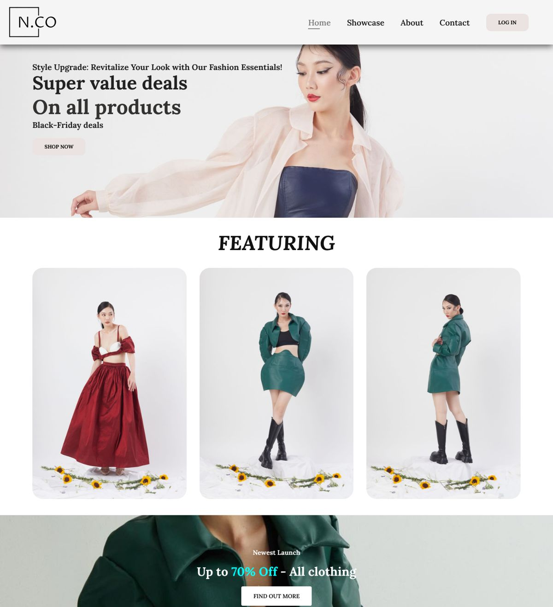

# Naeo Clothing Brand Website

A front-end website for **N.CO**, a fashion brand concept, built with plain HTML, CSS and JavaScript. It has a home page, a product showcase, an about page with a fashion video, and a contact form, and it works on desktop, tablet and phone screens.

**Live demo:** https://dwong3393-creator.github.io/naeo-clothing-website/



## Features

- Responsive layout: full menu on laptops and desktops, slide-out menu on tablets and phones
- Hero banners, a featured-looks grid and promotional banners on the home page
- Product showcase grid with item cards
- Video showcase on the About page
- Contact form and a pop-up login / register panel (front end only)
- Success messages with SweetAlert2, icons from Font Awesome and Boxicons

## Built with

- HTML5 and CSS3 (Flexbox, Grid, media queries)
- JavaScript (menu toggle, login pop-up)
- [SweetAlert2](https://sweetalert2.github.io/), [Font Awesome](https://fontawesome.com/), [Boxicons](https://boxicons.com/), Google Fonts (Lora)

## Pages

| Page | What it shows |
|---|---|
| `index.html` | Home: hero, featured looks, sale banners, newsletter sign-up |
| `showcase.html` | Product showcase grid |
| `about.html` | Brand intro and fashion video |
| `contact.html` | Feedback form |

## Run it locally

No build step is needed. Download or clone the repository and open `index.html` in a browser.

```
git clone https://github.com/dwong3393-creator/naeo-clothing-website.git
```

## Notes

This is a front-end project. The login, register, newsletter and contact forms are not connected to a server, so they show a confirmation message without saving anything. A fuller version with user accounts, a cart and checkout (PHP and MySQL) is a separate project.

## Screenshots

| Showcase (desktop) | Home (phone) |
|---|---|
|  |  |

---
Designed and built by Dickson Wong.
